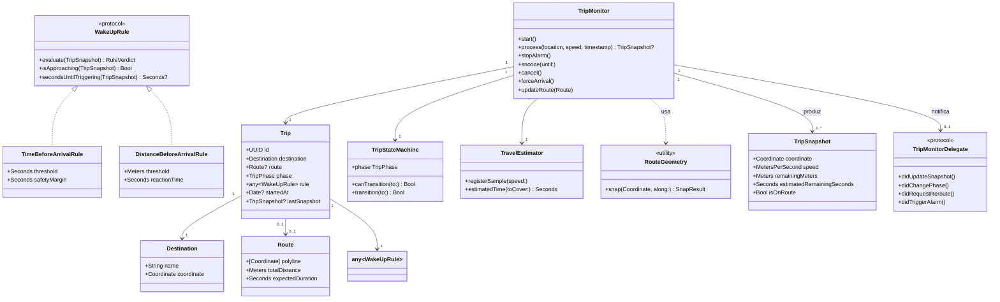
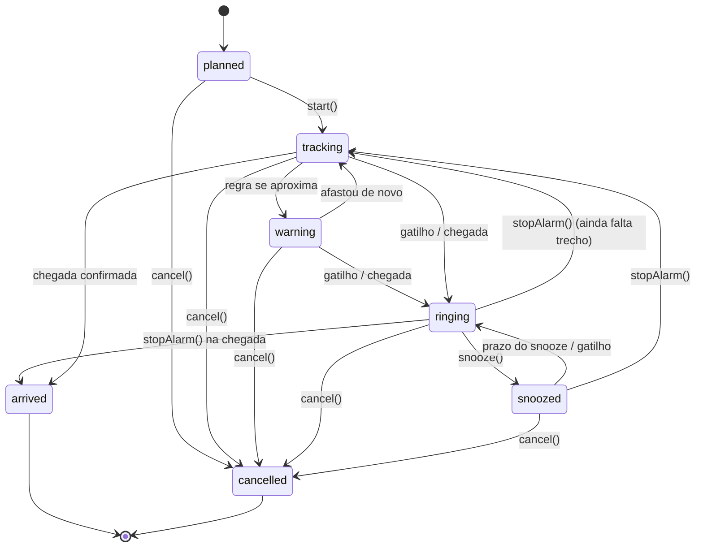
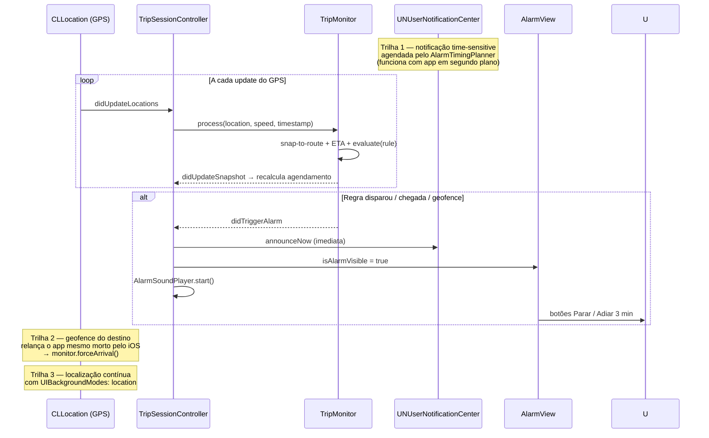

# 02 — Arquitetura

## 2.1 Estilo: Clean Architecture em 3 camadas

```
                    ┌──────────────────────────────────────────────┐
   UI (SwiftUI)  →  │ App/          Presentation · Services ·      │
                    │               Adapters · CompositionRoot     │
                    ├──────────────────────────────────────────────┤
   Persistência  →  │ AcordeAquiData   JsonTripRepository ·        │
                    │                 JsonSettingsRepository       │
                    ├──────────────────────────────────────────────┤
   Regras/Negócio → │ AcordeAquiDomain Entidades · Strategies ·    │
                    │                 Estado · Geometria · ETA ·   │
                    │                 Alarme · Portas (protocolos) │
                    └──────────────────────────────────────────────┘
```

**Regra de dependência:** dependências sempre apontam para dentro.
O domínio **não importa** SwiftUI, MapKit, CoreLocation, UserNotifications ou
Foundation pesado — apenas `Foundation` básico (`Date`, `JSONEncoder`, `UUID`),
o que permite compilar e testar o núcleo em **Windows, macOS e Linux**.

Todas as fronteiras são **protocolos definidos no domínio** (DIP) e
implementadas na camada de App:

| Porta no domínio | Implementação (Adapter) |
|---|---|
| `RoutePlanning` | `MapKitRouteProvider` (MKDirections) |
| `PlaceSearching` | `MapKitPlaceSearcher` (MKLocalSearch) |
| `AlarmScheduling` | `NotificationAlarmScheduler` (UserNotifications) |
| `TripRepository` / `SettingsRepository` | `JsonTripRepository` / `JsonSettingsRepository` |
| `Clock` | `SystemClock` (testes usam `MockClock`) |
| `TripMonitorDelegate` (Observer) | `TripSessionController` |

## 2.2 Padrões GoF e SOLID aplicados

| Princípio / Padrão | Onde | Como |
|---|---|---|
| **Strategy** | `Rules/WakeUpRule.swift` + `TimeBeforeArrivalRule`, `DistanceBeforeArrivalRule` | o `TripMonitor` avalia `trip.rule.evaluate(...)` sem conhecer o tipo concreto; trocar a regra não toca em mais nada |
| **State** | `Trip/TripStateMachine.swift` | tabela explícita de transições legais (`planned → tracking → warning → ringing → …`); transições ilegais são rejeitadas |
| **Observer** | `Trip/TripMonitorDelegate.swift` | o monitor notifica snapshots, fases, reroutes e gatilhos; observadores implementam só o que precisam (implementações vazias padrão) |
| **Adapter** | `App/Adapters/*` | embrulham MapKit/CoreLocation/UserNotifications atrás de portas do domínio |
| **Repository** | `Persistence/Repositories.swift` + `AcordeAquiData` | CRUD de viagens/configurações atrás de interface; trocar JSON por CoreData/SwiftData não afeta o domínio |
| **Factory** | `Trip/TripFactory.swift` | cria `Trip` e regras a partir da configuração do usuário (inclui conversão imperial/métrico) |
| **Facade** | `App/Services/TripSessionController.swift` | uma única API (`begin/stopAlarm/snooze/cancelTrip`) escondendo monitor + localização + notificações + som + persistência |
| **Proxy (cache)** | `TripSessionController.rescheduleNotificationIfNeeded` | só reescreve a notificação quando o horário mudou >15 s (evita I/O a cada update de GPS) |
| **DIP / DI** | `CompositionRoot` | único ponto que conhece classes concretas; tudo injetado por construtor; **zero singletons** (o `UNUserNotificationCenter` fica isolado no adapter) |
| **Interface Segregation** | portas pequenas | `RoutePlanning`, `PlaceSearching`, `AlarmScheduling` separados — ninguém depende de interfaces que não usa |
| **Open/Closed** | `WakeUpRuleCodec` | nova regra = nova classe + 1 `case` no codec; monitor e UI não mudam |

### SOLID na prática
- **S** — cada classe tem um motivo único (`TravelEstimator` só estima velocidade; `RouteGeometry` só faz geometria).
- **O** — adicionar regra nova não modifica `TripMonitor`.
- **L** — qualquer `WakeUpRule` substitui outra em qualquer contexto.
- **I** — portas mínimas e coerentes (ver tabela acima).
- **D** — módulos de alto nível dependem de abstrações, nunca de MapKit.

## 2.3 Diagrama de classes (simplificado)



## 2.4 Diagrama de estados da viagem



Transições fora da tabela são **rejeitadas** por `TripStateMachine`
(ex.: `planned → ringing`), cobertas por testes.

## 2.5 Sequência — início de viagem

```mermaid
sequenceDiagram
    actor U as Usuário
    participant V as TripPlanView
    participant VM as TripPlanViewModel
    participant CR as CompositionRoot
    participant RP as MapKitRouteProvider
    participant S as TripSessionController
    participant L as CoreLocationTracker

    U->>V: marca destino + regra + "Iniciar viagem"
    V->>VM: startTrip(root:)
    VM->>CR: startTrip(destination:rule:)
    CR->>L: lastKnownCoordinate
    CR->>RP: planRoute(from:to:) async
    RP-->>CR: Route (polyline + ETA)
    CR->>CR: TripFactory.makeTrip(...)
    CR->>S: TripSessionController(...); begin()
    S->>L: startUpdates + monitorDestination(geofence)
    S->>S: monitor.start() (planned → tracking)
    S-->>V: fullScreenCover(item: root.session)
```

## 2.6 Sequência — disparo do alarme (tripla trava)



## 2.7 Convenções

- **Swift 5.9+ / iOS 17+**, idioma PT-BR nas strings de UI.
- Value objects imutáveis (`Meters`, `Seconds`, `Coordinate`) — unidades tipadas
  para impedir confundir km com m.
- Entidades de vida longa são **classes** (`Trip`, `TripMonitor`); o resto é
  `struct`/`enum` sempre que possível.
- Toda função pura do domínio tem teste correspondente (ver `docs/04`).
- Sem `static var` compartilhado (sem singletons); dependências chegam pelo
  construtor via `CompositionRoot`.
